# StreamX API

<p align="center">
  <a href="https://github.com/imzyrix/streamx-api">
    
  </a>
</p>

> Keyless, self-hostable **movie & TV metadata, artwork, scores, credits and where-to-watch** API — runs on **Cloudflare Pages Functions, Vercel, Railway, Render or any Docker host**. Catalogues, search, full poster/backdrop/logo sets, episode stills, critic & audience ratings, cast & crew, person bios, similar titles, streaming availability and rich facts from Wikidata, Wikipedia, Rotten Tomatoes, Metacritic, JustWatch, TVmaze and AniList.

```
https://api.streamx.qzz.io
```

**No API keys. No sign-up. No secrets.** Everything is read from public endpoints and cached at the edge. Version **1.3.0**.

[](https://github.com/imzyrix/streamx-api/releases)
[](https://ghcr.io/imzyrix/streamx-api)
[](https://www.npmjs.com/package/@imzyrix/streamx-api-mcp)

[](https://deploy.workers.cloudflare.com/?url=https://github.com/imzyrix/streamx-api)
[](https://vercel.com/new/clone?repository-url=https://github.com/imzyrix/streamx-api)
[](https://railway.app/new/template?template=https://github.com/imzyrix/streamx-api)
[](https://render.com/deploy?repo=https://github.com/imzyrix/streamx-api)

**Use it hosted — or fork it and run your own.** → [Self-hosting & forks](#self-hosting--forks) · **Using an AI agent?** → [For AI agents](#for-ai-agents)

Made by **[@imzyrix](https://github.com/imzyrix)** · part of **[@zyrixdevs](https://github.com/zyrixdevs)**

[](LICENSE)
[](LICENSE-DOCS)
